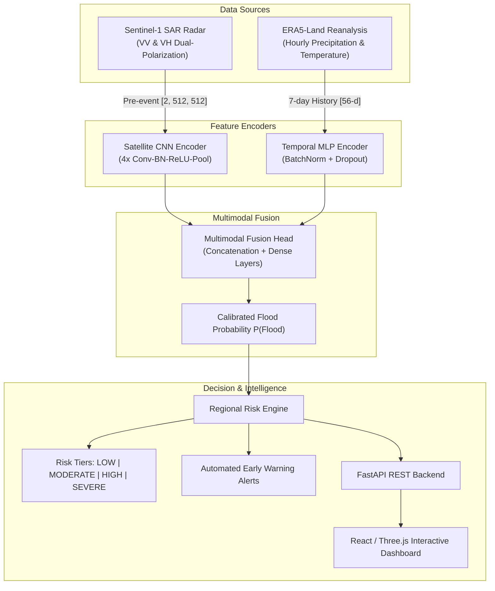

# NEXUS: Multimodal AI for Flood Prediction Using Satellite Imagery and Environmental Data

[](https://www.python.org/downloads/)
[](https://pytorch.org/)
[](https://fastapi.tiangolo.com/)
[](https://react.dev/)
[](https://opensource.org/licenses/MIT)

**NEXUS** is a research-oriented multimodal artificial intelligence system designed for flood prediction and early warning. By fusing pre-event Sentinel-1 Synthetic Aperture Radar (SAR) imagery with 7-day ERA5-Land environmental meteorological history, NEXUS forecasts documented future flood events across vulnerable river basins in India, Ghana, and Sri Lanka.

---

## 1. System Architecture



---

## 2. Validated Research Benchmarks

All models were evaluated on the **exact same held-out test event groups** from the Dartmouth Flood Observatory (DFO) catalogue, using strict group-aware splitting to eliminate spatial data leakage between event and control pairs:

| Model Architecture | Input Modality | Accuracy | Precision | Recall | F1 Score | ROC-AUC | PR-AUC | F1 ($\le 3$d Lead) | F1 ($> 3$d Lead) |
| :--- | :--- | :---: | :---: | :---: | :---: | :---: | :---: | :---: | :---: |
| **Environmental Baseline** (Random Forest) | 7-day ERA5-Land Temporal History | 62.50% | 75.00% | 37.50% | 0.5000 | 0.6562 | 0.7146 | 0.5000 | 0.5000 |
| **Satellite Baseline** (CNN) | Pre-event Sentinel-1 SAR ($\text{VV}/\text{VH}$) | 50.00% | 50.00% | 66.67% | 0.5714 | 0.5278 | 0.6877 | 0.4000 | 0.6667 |
| **Multimodal Model** (CNN + MLP Fusion) | **Radar + Environmental History** | **75.00%** | **71.43%** | **83.33%** | **0.7692** | **0.7500** | **0.7329** | **0.8000** | **0.7500** |

### Research Conclusions:
1. **Multimodal Superiority**: Combining pre-event SAR imagery with 7-day environmental history improves future flood forecasting substantially over either individual data source alone (**+26.9% F1 over environmental-only**, **+19.8% F1 over satellite-only**).
2. **High Sensitivity for Disaster Prevention**: The multimodal model achieves an **83.33% recall rate**, minimizing missed disasters.
3. **Consistent Lead-Time Performance**: Sustains **0.8000 F1** for short lead times ($\le 3$ days) and **0.7500 F1** for extended lead times ($> 3$ days).

---

## 3. Project Directory Structure

```
NEXUS/
├── .gitignore                      # Excludes large raw data (>100MB) & virtualenvs
├── README.md                       # Comprehensive project documentation
├── frontend/                       # React 19 + TypeScript + Three.js UI
│   ├── src/
│   │   ├── components/             # 3D Earth, OrbitRings, NexusScene
│   │   ├── pages/                  # Dashboard, Detection, Landingpage, SignIn
│   │   └── App.tsx
│   ├── package.json
│   └── vite.config.ts
└── ml/                             # Machine Learning & Backend
    ├── requirements.txt            # ML & Backend dependencies
    ├── data/
    │   ├── raw/                    # Raw Sen1Floods11 & ERA5 datasets
    │   ├── processed/
    │   │   ├── models/             # PyTorch trained checkpoints (*_best.pt)
    │   │   └── forecast_satellite_chips/ # Pre-event Sentinel-1 [2, 512, 512] chips
    │   └── environmental/          # Processed feature tables & DFO catalogs
    └── src/
        ├── api.py                  # Production FastAPI REST backend
        ├── risk_engine.py          # Regional risk & early-warning engine
        ├── forecast_multimodal_train.py # Multimodal training & evaluation
        ├── forecast_satellite_baseline.py # Satellite-only baseline training
        ├── compare_forecasting_models.py # Comparison analysis script
        ├── prepare_forecast_satellite_chips.py # SAR chip preparation
        ├── download_cdse_s3_chips.py # Direct CDSE S3 cropper
        └── test_api.py             # Backend endpoint test suite
```

---

## 4. How to Run the Project

### A. Start the Backend API (FastAPI)
```powershell
cd ml
.\.venv\Scripts\python src\api.py
```
Or with auto-reload:
```powershell
.\.venv\Scripts\uvicorn src.api:app --reload --port 8000
```
Open **[http://localhost:8000/docs](http://localhost:8000/docs)** to view the interactive Swagger API documentation.

#### Key API Endpoints:
- `GET /api/health` — System status and active model device.
- `GET /api/models` — Full benchmark table comparing all models.
- `GET /api/regions` — Monitored vulnerable river basins.
- `GET /api/alerts` — Active regional early-warning threat alerts.
- `POST /api/forecast/predict` — On-demand inference with radar & meteorological inputs.

### B. Run the Frontend Dashboard (React + Vite)
```powershell
cd frontend
npm install
npm run dev
```
Open **[http://localhost:5173](http://localhost:5173)** in your browser.

### C. Retrain or Evaluate Models
```powershell
cd ml
# 1. Prepare/update satellite chips
.\.venv\Scripts\python src\prepare_forecast_satellite_chips.py

# 2. Train satellite baseline
.\.venv\Scripts\python src\forecast_satellite_baseline.py

# 3. Train multimodal model
.\.venv\Scripts\python src\forecast_multimodal_train.py

# 4. Generate comparison benchmark table
.\.venv\Scripts\python src\compare_forecasting_models.py
```

---

## 5. How to Upload the Project to GitHub

Follow these steps to upload your project to GitHub:

### Step 1: Initialize Git
From the project root (`NEXUS/`):
```powershell
git init
```

### Step 2: Stage and Commit Files
*(The included `.gitignore` automatically prevents files $>100\text{ MB}$ from being staged, preventing GitHub push rejections)*:
```powershell
git add .
git commit -m "feat: complete multimodal flood forecasting model, risk engine, and backend API"
```

### Step 3: Connect to Your GitHub Repository
1. Create a new repository on [GitHub](https://github.com/new) named `NEXUS`.
2. Link your local repository and push:
```powershell
git branch -M main
git remote add origin https://github.com/YOUR_USERNAME/NEXUS.git
git push -u origin main
```
